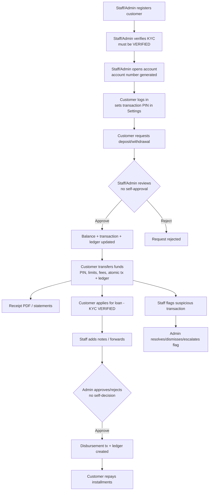
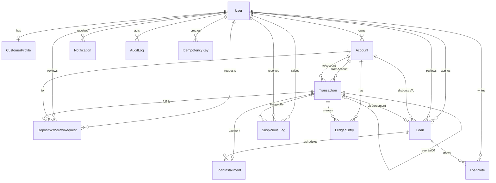
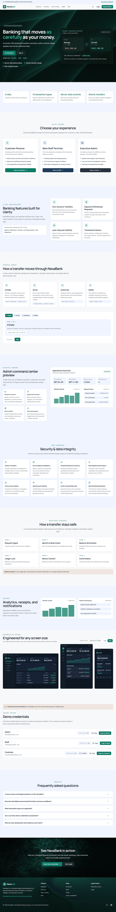
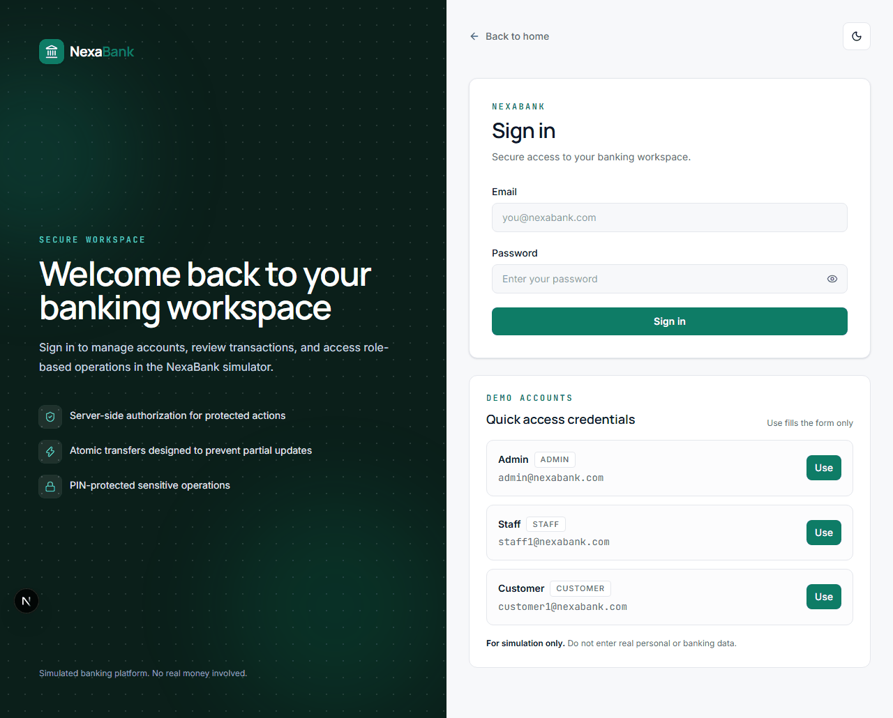

# NexaBank

NexaBank is a role-based digital banking simulation web application built with Next.js (App Router), TypeScript, Prisma, Neon/Postgres, NextAuth v5, Redux Toolkit/RTK Query, Tailwind CSS, and shadcn/ui.

**GitHub:** [nasirmasud/nexa-bank](https://github.com/nasirmasud/nexa-bank)

> **Simulation only.** No real money, real banking rails, or real payment processing. Do not enter real personal or banking data.

## 1. Project Overview

NexaBank simulates core banking workflows for three roles: **Admin**, **Staff**, and **Customer**. It focuses on secure role-based access, auditable money operations, and a modern dashboard UI.

Key capabilities include customer onboarding, account management, deposits/withdrawals via approval workflow, customer-to-customer transfers with PIN verification, loan application/review/disbursement/repayment, suspicious transaction flagging, notifications, audit logs, and admin analytics/settings.

## 2. Application Features

### Admin
- Dashboard analytics (KPIs, charts, work queues).
- Customer management and customer detail view (profile, KYC, accounts, recent transactions).
- Account creation and account controls (freeze/unfreeze, limits).
- Customer status management (activate/deactivate/block).
- Deposit/withdrawal request review (approve/reject, self-approval blocked).
- Loan review: forward/note, approve/reject, disbursement tracking, installment visibility.
- Transaction monitoring, flagging, and admin-only reversal.
- Suspicious flag review/resolution (admin-only resolution).
- Audit logs and bank-wide settings (limits/fees/loan rates).

### Staff
- Staff dashboard and operational queues.
- Register customers, verify/update KYC, view customer details.
- Create accounts and view customer/account/transaction context.
- Review deposit/withdrawal requests (approve/reject, self-approval blocked).
- Flag suspicious transactions; view suspicious queue (resolution by admin).
- Assist loans with notes/forwarding (no approve/reject).

### Customer
- Dashboard with balance/activity summary, account switcher (multi-account), active loans, and charts.
- Account list/detail and statement/receipt downloads (where available).
- Transfer funds with transaction PIN and idempotency protection.
- Deposit/withdrawal requests and request tracking.
- Loan application, loan details, installment repayment.
- Notifications and profile/settings (password/PIN/theme/2FA placeholder state).

### Bonus / Implemented Extras
- Atomic transfer flow with serializable retry, row locks, ledger entries, idempotency keys.
- Transaction PIN lockout and login lockout.
- Receipts (PDF) and statements (CSV/PDF).
- Dark mode support.
- Admin-configurable banking limits/fees.

## 3. User Roles & Permissions

| Action | ADMIN | STAFF | CUSTOMER |
|---|:---:|:---:|:---:|
| Login / session-based access | Yes | Yes | Yes |
| View own profile/notifications/settings | Yes | Yes | Yes |
| Register customers / create accounts (customer KYC must be VERIFIED before account creation) | Yes | Yes | No |
| View customers list/detail | Yes | Yes | No (own only where applicable) |
| Update KYC | Yes | Yes | No |
| View accounts / transactions / loans (operational) | Yes | Yes (read/support scope) | Own only |
| Flag suspicious transactions | Yes | Yes | No |
| **Resolve/dismiss/escalate suspicious flags** | **Yes** | **No** | **No** |
| Loan note / forward to review | Yes | Yes | No |
| **Loan approve / reject** | **Yes** (not own loan) | **No** | **No** |
| **Account freeze / unfreeze / set limits** | **Yes** | **No** | **No** |
| **Customer activate/deactivate/block** | **Yes** | **No** | **No** |
| **Transaction reverse** | **Yes** | **No** | **No** |
| **Bank-wide settings / audit logs** | **Yes** | **No** | **No** |
| **Manage staff accounts** | **Yes** | **No** | **No** |
| Deposit/withdraw request approve/reject | Yes | Yes (not self) | No |
| Create deposit/withdraw request | No | No | Yes |
| Transfer funds / repay loan / apply loan (loan application requires KYC VERIFIED) | No | No | Yes (own accounts) |

**Enforcement:** route guards (`src/proxy.ts`, `src/lib/guards.ts`) + service-layer checks (e.g. `loanService`, `accountService`, `customerService`, `transactionService`, `suspiciousFlagService`, `requestService`, `staffService`) + UI hiding for restricted actions.

## Role Responsibilities

### ADMIN

**Purpose:** Platform administrator responsible for oversight, approvals, sensitive controls, configuration, and auditability.

**What they can do**
- **Dashboard & analytics:** View platform KPIs, charts, and work queues (`/admin/dashboard`).
- **Customer management:** View/search customer list and customer detail, review KYC/profile data, and update customer account status (ACTIVE/INACTIVE/BLOCKED) (`/admin/customers`, `/admin/customers/[id]`).
- **Staff management:** View/search staff users, create staff accounts with a temporary password, and activate/deactivate staff accounts (`/admin/staff`).
- **Account management:** View accounts, open new accounts for customers, view account details, freeze/unfreeze accounts, and set account limits (`/admin/accounts`, `/admin/accounts/new`, `/admin/accounts/[id]`).
- **Requests:** Review deposit/withdrawal requests and approve/reject them (`/admin/requests`). Self-approval is blocked.
- **Transactions:** View/monitor transactions and perform admin-only reversal where allowed (`/admin/transactions`).
- **Loans:** Review loans, add notes/forward, and approve/reject loans (not own loan decision) (`/admin/loans`, `/admin/loans/[id]`).
- **Suspicious activity:** View flags and resolve/dismiss/escalate suspicious flags (`/admin/suspicious`).
- **System controls:** Manage bank-wide settings and view audit logs (`/admin/settings`, `/admin/audit-logs`).

**What they cannot do (server-enforced, not UI-only)**
- Cannot approve/reject their own deposit/withdrawal request (`assertNotSelf` / service checks in request flow).
- Cannot approve/reject their own loan decision (loan service self-decision guard).
- Cannot deactivate their own account through staff management; cannot create or promote ADMIN users via staff management (role is server-assigned as STAFF; strict Zod rejects `role`).
- Cannot bypass route/API role guards: `/admin/*` and `/api/admin/*` are restricted by `src/proxy.ts`; APIs also enforce `requireRole`/service checks.
- Sensitive actions remain enforced in service layer even if UI is manipulated.

**Dashboard (`/admin/dashboard`)**
- **KPIs:** Total Bank Balance (with sparkline), Total Deposits, Total Withdrawals, Total Customers, Total Accounts, Total Transactions, Pending Loan Applications.
- **Secondary chips:** Active Loans, Open Flags, Pending Requests.
- **Charts:** Monthly Transaction Volume, Deposit vs Withdrawal, Account Distribution, Loan Approval Statistics, Monthly Banking Activity (3M/6M/12M range).
- **Work queues:** Suspicious queue (open flags), Pending loan applications (PENDING/UNDER_REVIEW), Recent transactions.

### STAFF

**Purpose:** Operations/support role for customer onboarding, account assistance, request review, and risk/loan triage.

**What they can do**
- **Dashboard & operations:** View operational KPIs and work queues (`/staff/dashboard`).
- **Customer management:** Register customers, search/view customer list and detail, update KYC status (`/staff/customers`, `/staff/customers/[id]`).
- **Account management:** View accounts, open new accounts for customers, view account details (`/staff/accounts`, `/staff/accounts/new`, `/staff/accounts/[id]`).
- **Requests:** Review deposit/withdrawal requests and approve/reject them (`/staff/requests`). Self-approval is blocked.
- **Transactions:** View transactions in staff scope (`/staff/transactions`).
- **Suspicious activity:** Flag suspicious transactions and view suspicious queue (`/staff/suspicious`, transaction flag actions). Resolution is admin-only.
- **Loans:** View loans and assist with notes/forwarding (`/staff/loans`, `/staff/loans/[id]`); cannot approve/reject.

**What they cannot do (server-enforced, not UI-only)**
- Cannot approve/reject loans (`loanService` admin-only checks).
- Cannot resolve/dismiss/escalate suspicious flags (`suspiciousFlagService` admin-only resolution).
- Cannot freeze/unfreeze accounts or set account limits (`accountService` admin-only checks).
- Cannot update customer account status / block-deactivate-activate (`customerService` admin-only check).
- Cannot reverse transactions (`transactionService` admin-only check).
- Cannot access bank-wide settings or audit logs (no staff nav; route/API/service guards restrict admin areas).
- Cannot manage staff accounts (create/activate/deactivate) — ADMIN only (`/api/admin/staff*`, route + service enforced).
- Cannot approve/reject own request (self-approval guard).

**Dashboard (`/staff/dashboard`)**
- **KPIs:** Pending Requests, Pending Loans, Open Suspicious Flags, Recent Transactions.
- **Work queues/panels:** Pending requests, Suspicious queue (open flags), Loans needing attention (PENDING/UNDER_REVIEW), Recent transactions.

### CUSTOMER

**Purpose:** End-user banking role for managing own accounts and performing self-service banking actions.

**What they can do**
- **Dashboard:** View own balances/activity summary, account switcher (multi-account), charts, and active loans (`/customer/dashboard`).
- **Accounts:** View own accounts and account details/statements where available (`/customer/accounts`, `/customer/accounts/[id]`).
- **Transfers:** Transfer funds from own active accounts with PIN and idempotency protection (`/customer/transfer`).
- **Requests:** Create deposit/withdrawal requests and track/cancel own pending requests (`/customer/requests`).
- **Transactions:** View own transactions and receipt/statement downloads where available (`/customer/transactions`, `/customer/transactions/[id]`).
- **Loans:** Apply for loans, view loan details, and repay installments (`/customer/loans`, `/customer/loans/apply`, `/customer/loans/[id]`).
- **Notifications & settings:** View notifications and manage profile/password/PIN/theme/2FA placeholder state (`/customer/notifications`, `/customer/settings`).

**What they cannot do (server-enforced, not UI-only)**
- Cannot access admin/staff areas (`src/proxy.ts` role-area checks; layout/API guards).
- Cannot view/manage other customers' resources; ownership checks restrict accounts/transactions/loans/requests.
- Cannot create customers/accounts, review requests, flag/resolve suspicious as staff/admin workflow, approve/reject loans, freeze/limits, reverse transactions, or change bank settings.
- Cannot bypass PIN/validation/idempotency/business-rule checks on money actions (service-layer enforcement).

**Dashboard (`/customer/dashboard`)**
- **KPIs:** Total Balance, Total Deposits, Total Withdrawals, Active Loans.
- **Sections:** Recent Transactions, Account Info (selected account), Monthly Spending chart, Monthly Deposit History chart, Transaction Distribution chart, Active Loans table.
- **Controls:** Account switcher (when multiple accounts), quick links to Accounts/Transfer.

## Who approves what

| Action | Who performs | Who approves / resolves | Restriction / note |
|---|---|---|---|
| Customer registration | Staff or Admin | N/A (created directly) | Customers cannot self-register; enforced by role/route/service restrictions. |
| Open account | Staff or Admin | N/A (created directly) | Customer KYC must be **VERIFIED** before account creation. Account number generated on creation; account tied to customer owner. |
| Deposit/withdrawal request | Customer creates | Staff or Admin approves/rejects | Requester cannot approve/reject own request (`assertNotSelf`); approval executes money movement atomically with ledger/audit records. |
| Loan application | Customer applies | Admin only approves/rejects | Customer KYC must be **VERIFIED** before applying. Staff may add notes/forward; admin cannot approve/reject own loan decision; disbursement creates transaction/ledger entries. |
| Loan installment repayment | Customer repays | N/A (customer action) | Ownership/balance/business rules enforced in service layer. |
| Suspicious flag | Staff or Admin raises (and system/flow can create flags) | Admin resolves/dismisses/escalates | Staff can flag/view but cannot resolve; enforced in `suspiciousFlagService`. |
| Account freeze/unfreeze/limits | Admin only | Admin only | Enforced in `accountService` and route guards. |
| Customer status (activate/deactivate/block) | Admin only | Admin only | Enforced in `customerService`; status change can bump session version. |
| Transaction reversal | Admin only | Admin only | Enforced in `transactionService`; creates compensating reversal/ledger records. |
| Bank settings / audit log access | Admin only | Admin only | `/admin/settings`, `/admin/audit-logs`, admin APIs/services. |

## Checks and balances

- **No self-approval / no self-decision:** `assertNotSelf` and service checks prevent approving/rejecting own deposit/withdrawal requests and making own loan approval decisions.
- **Role separation:** Staff supports operations (onboarding, KYC, requests, flagging, loan notes/forwarding) but cannot perform admin-only sensitive actions (loan approve/reject, suspicious resolution, freeze/limits, customer status, reversal, settings/audit, staff management).
- **Server-side enforcement:** `src/proxy.ts` enforces auth/role areas; `requireAuth`/`requireRole` guard APIs/layouts; service-layer checks enforce ownership, role, and business rules even if UI is bypassed.
- **Auditability:** Critical actions write audit logs (`AuditLog` / audit service paths), supporting traceability for administrative and money-related operations.

## Typical Workflow (How the system is used)

> **Demo note:** `customer1@nexabank.com` has seeded accounts and demo data. A newly registered customer starts with **no account**; staff/admin must verify KYC and open an account before the customer can request deposits, transfer, or apply for loans tied to an account.

1. **Staff/Admin registers a customer.** Customers cannot self-register. Admin/Staff create the customer record; newly created users receive a temporary password and must change it at first login.
2. **Staff/Admin verifies KYC.** Customer KYC status is reviewed/updated. Account creation and loan application require KYC **VERIFIED**.
3. **Staff/Admin opens an account.** An account is created for the verified customer and the account number is generated at creation time.
4. **Customer logs in and sets a transaction PIN.** From Customer Settings, the customer sets/updates their transaction PIN. The PIN is required for PIN-gated money actions such as transfers.
5. **Customer requests a deposit (or withdrawal); Staff/Admin approves.** The customer submits a deposit/withdrawal request. Staff/Admin reviews and approves or rejects it; self-approval is blocked. On approval, balance/transaction/ledger records are updated atomically.
6. **Customer transfers money.** The customer transfers from an owned active account using their transaction PIN. The system enforces ownership, limits, fees, sufficient funds/min balance, idempotency, serializable DB transaction, row locks, and ledger entries. Receipt PDF and account statements are available.
7. **Loan lifecycle.** The verified customer applies for a loan. Staff can add notes and forward the loan for review; **only Admin can approve or reject** (and not their own loan). Admin approval/disbursement creates disbursement transaction/ledger entries. The customer repays installments from their account.
8. **Staff flags suspicious transactions; Admin resolves them.** Staff/Admin can flag suspicious activity. Only Admin can resolve/dismiss/escalate suspicious flags.



## 4. Security & Authentication

- **Auth library / session:** NextAuth v5 (`next-auth@beta`) Credentials provider (`src/lib/auth.ts`). JWT sessions include `id`, `role`, and `sessionVersion`.
- **Forced password change:** Users created with a temporary/generated password are flagged with `mustChangePassword=true`. `requireAuth` blocks normal APIs for flagged users with `403 PASSWORD_CHANGE_REQUIRED` (except `GET /api/me`, `POST /api/me/password`, and sign-out). Dashboard layouts redirect flagged users to `/change-password`. Password change reuses the existing password flow with lockout/rate-limit behavior, requires the new password to differ from the current/temp password, clears the flag on success, bumps `sessionVersion`, and writes an audit log. The client re-signs in after a successful change because the session version changes.
- **Session invalidation (`sessionVersion`):** `requireAuth` reads the DB user on every request and rejects stale JWTs when token `sessionVersion` does not match DB `sessionVersion` (401). Password changes and security-relevant status changes (e.g., deactivation) bump `sessionVersion` to invalidate existing sessions.
- **Server-side role checks:** `src/proxy.ts` protects `/admin`, `/staff`, `/customer`, and `/api` (except `/api/auth`), redirects unauthenticated page requests to `/login?callbackUrl=...`, returns 401 JSON for protected API requests, and enforces role-area access. `requireAuth` / `requireRole` in `src/lib/guards.ts` enforce authentication, active status, role, and forced-password state; service-layer checks enforce ownership/role/business rules even if UI is bypassed.
- **Login protections:** Passwords verified with bcrypt; failed login counter; lockout after 5 failed attempts for 15 minutes; inactive/blocked users cannot sign in.
- **Transaction PIN lockout:** Customer money actions (e.g., transfer) verify hashed PIN (`pinHash`), track failed PIN attempts, and lock PIN for 15 minutes after 3 failures.
- **2FA:** `twoFactorEnabled` field exists; full TOTP 2FA enrollment/enforcement is not implemented yet (demo accounts should be treated as 2FA off).

## 5. Redux Toolkit Architecture

### Store setup
- Store factory: `src/store/index.ts` (`makeStore`).
- Typed hooks/types: `RootState`, `AppDispatch`, `AppStore`.
- RTK Query API reducer mounted as `[baseApi.reducerPath]`.

### Slices
Located in `src/store/slices/`:
- `authSlice`
- `uiSlice`
- `accountSlice`
- `transactionSlice`
- `loanSlice`
- `notificationSlice`

### Middleware
- `baseApi.middleware` (RTK Query)
- `loadingMiddleware` (`src/store/middleware/loadingMiddleware.ts`) for request loading state handling.

### Folder tree (state/API)
```text
src/store/
  index.ts
  api/
    baseApi.ts
    accountsApi.ts
    analyticsApi.ts
    auditLogsApi.ts
    customersApi.ts
    loansApi.ts
    notificationsApi.ts
    profileApi.ts
    requestsApi.ts
    settingsApi.ts
    suspiciousFlagsApi.ts
    transactionsApi.ts
  middleware/
    loadingMiddleware.ts
  slices/
    accountSlice.ts
    authSlice.ts
    loanSlice.ts
    notificationSlice.ts
    transactionSlice.ts
    uiSlice.ts
```

## 6. RTK Query Implementation

- **Base API:** `src/store/api/baseApi.ts` using `createApi` + `fetchBaseQuery`.
- **Base URL:** `/api`, `credentials: "include"`.
- **Custom base query:** wraps errors into `{ status, code, message, fields }`; shows toast errors (Sonner); on 401 in browser, shows session-expired toast and signs out to `/login`.
- **Tag types:** `Account`, `Transaction`, `Request`, `Loan`, `Notification`, `Customer`, `Analytics`, `Settings`, `Profile`, `SuspiciousFlag`, `AuditLog`.
- **Invalidation pattern:** mutations invalidate relevant tags/lists (e.g., transfer/request/loan actions invalidate account/transaction/request/loan/notification tags as applicable in endpoint files).
- **401 handling:** centralized in base query; protected pages/layouts also redirect on UNAUTHORIZED where needed.

## 7. Transaction Processing Logic

### Transfer flow (step-by-step)
1. **Auth & role:** customer-only endpoint/service (`POST /api/transfers`, `transferService.transfer`).
2. **Input validation:** Zod schema validates amount, source account, recipient account number, PIN, idempotency key.
3. **Idempotency (fast path):** check existing `IdempotencyKey` for user+key; return stored response if present.
4. **PIN verification:** bcrypt compare against `pinHash`; failed attempts tracked; lock after 3 failures (15 min).
5. **Serializable transaction:** run in Prisma transaction with serializable retry helper (`withSerializableRetry`).
6. **Idempotency inside tx:** re-check/create key to handle races; duplicate in-progress returns conflict.
7. **Load & validate accounts:** source owned by customer, recipient exists, not same account, both ACTIVE, owners ACTIVE.
8. **Deterministic row locks:** `SELECT ... FOR UPDATE` on both account IDs in sorted order.
9. **Business rules:** per-tx limit, daily limit, sufficient funds, minimum balance, fee calculation (same-owner transfer fee waived).
10. **Atomic updates:** update balances, create `Transaction` (COMPLETED), create `LedgerEntry` rows (DEBIT/CREDIT), create SYSTEM fee credit ledger if fee > 0.
11. **Notifications:** create sender/recipient notifications.
12. **Idempotency store:** save response JSON in `IdempotencyKey`.

### Other money/request flows
- **Deposits/withdrawals:** customer creates request; admin/staff approve/reject; approval executes money movement in service layer with ledger/transaction records. Self-approval blocked.
- **Loan disbursement:** admin approves loan; disbursement creates transaction/ledger entries.
- **Loan repayment:** customer repays installment; creates repayment transaction/ledger and updates installment/loan state.
- **Reversal:** admin-only; creates reversal transaction and compensating ledger entries (service-layer enforced).
- **Audit logging:** important actions write `AuditLog` records.

## 8. Database Structure

### Main models
- **User / CustomerProfile:** identity, role/status, auth/PIN fields, KYC profile.
- **Account:** account number, owner, type/status, balance, limits/min balance.
- **Transaction / LedgerEntry:** immutable money records; ledger is source of account movement history.
- **IdempotencyKey:** prevents duplicate transfer processing.
- **DepositWithdrawRequest:** approval workflow for deposits/withdrawals.
- **Loan / LoanInstallment / LoanNote:** loan lifecycle, schedule, repayment, review notes.
- **SuspiciousFlag:** staff/admin/system flags for transactions.
- **Notification:** in-app user notifications.
- **AuditLog:** actor/action/entity/before-after trace.
- **Settings:** bank-wide configurable limits/fees/rates.

### Mermaid ER diagram (simplified)


## 9. Security Implementation

- **Route protection:** `src/proxy.ts` enforces auth and role-area access; API returns 401/403 JSON.
- **Server-side authz:** `requireAuth`/`requireRole` in API routes and layouts; service-layer role checks for sensitive actions.
- **Ownership checks:** account/transaction/loan/request access scoped by role and owner where applicable.
- **Sensitive action restrictions:** admin-only for loan approve/reject, freeze/unfreeze/limits, customer status, tx reverse, suspicious-flag resolution, settings/audit.
- **Self-approval guard:** `assertNotSelf` prevents approving/rejecting own request and self loan decisions.
- **PIN security:** bcrypt-hashed PIN, failed-attempt tracking, temporary PIN lockout.
- **Login lockout:** failed login count + temporary lock.
- **Temporary passwords:** admin/staff-created temporary passwords set `mustChangePassword`; `requireAuth` blocks normal APIs with `PASSWORD_CHANGE_REQUIRED` until password is changed via the allowed password-change flow, and dashboards redirect to `/change-password`.
- **Session invalidation:** `sessionVersion` is checked on every `requireAuth` DB read; password changes and staff deactivation/session-sensitive actions bump version to invalidate old sessions.
- **Atomic money ops:** serializable transactions, deterministic row locks, ledger entries, idempotency keys.
- **Audit logs:** critical operations recorded.
- **Input validation:** Zod schemas in API/service boundaries.
- **Secrets:** no secrets committed; `.env*` ignored; `.env.example` committed.
- **Known hardening gaps:** full 2FA/TOTP enrollment and enforcement not complete.

## 10. Environment Variables

| Name | Required | Description | Example |
|---|---|---|---|
| `DATABASE_URL` | Yes | Primary Postgres/Neon connection string (pooled/runtime recommended). | `postgresql://...` |
| `DIRECT_URL` | Yes | Direct Postgres connection for Prisma migrations/introspection. | `postgresql://...` |
| `TEST_DATABASE_URL` | Yes (tests) | Separate Postgres DB for integration tests. | `postgresql://.../nexa_test?schema=public` |
| `AUTH_SECRET` | Yes | NextAuth secret for signing/encryption. | `long-random-secret` |
| `NEXTAUTH_URL` | Yes | App base URL used by auth in deployed/local env. | `http://localhost:3000` |
| `BANK_TIMEZONE` | Optional | Banking timezone for date logic where used. | `Asia/Dhaka` |

See `.env.example`. Never commit real `.env` values.

## 11. Local Setup Instructions

### Prerequisites
- Node.js 20+ (recommended 22)
- npm
- Postgres database (Neon or local Postgres)
- Separate test database for integration tests

### Install
```bash
npm install
```

### Configure environment
1. Copy `.env.example` to `.env`.
2. Fill required values (do not commit `.env`).

### Prisma
```bash
npx prisma generate
npx prisma migrate deploy
```

### Seed demo data
```bash
npm run db:seed
npm run seed:demo
```

> For Neon/remote, use `DIRECT_URL` as `DATABASE_URL` per command only if needed; do not print credentials.

### Run app
```bash
npm run dev
```
Open [http://localhost:3000](http://localhost:3000).

### Tests/checks
```bash
npm run lint
npm run typecheck
npm run test
npm run build
```

## 12. Deployment Instructions (Vercel + Neon)

1. **Create Neon DB** (or branch). Get pooled `DATABASE_URL` and direct `DIRECT_URL`.
2. **Import repo into Vercel**.
3. **Set env vars** in Vercel: `DATABASE_URL`, `DIRECT_URL`, `AUTH_SECRET`, `NEXTAUTH_URL` (production URL), `BANK_TIMEZONE`. Do **not** set `TEST_DATABASE_URL` in Vercel.
   - **Neon/pooling note:** runtime uses `DATABASE_URL`; Prisma migrations use `DIRECT_URL`. This app uses Serializable transactions and `FOR UPDATE` row locks for money flows; verify your Neon pooler mode/connection strategy in production (prefer direct/runtime-compatible settings if you see transaction isolation issues).
4. **Deploy**. The app build runs `prisma generate && next build` (see `package.json`). Vercel install/build should work without extra hooks.
5. **Run migrations** against production DB:
   ```bash
   npx prisma migrate deploy
   ```
6. **Seed demo data** (optional, after Neon backup branch):
   ```bash
   npm run db:seed
   npm run seed:demo
   ```
7. **Verify** login for all demo roles and key flows on live URL.

## 13. Demo Credentials

From `src/lib/demo-credentials.ts` and seed scripts:

| Role | Email | Password | Transaction PIN |
|---|---|---|---|
| Admin | `admin@nexabank.com` | `Password@123` | — |
| Staff | `staff1@nexabank.com` | `Password@123` | — |
| Customer | `customer1@nexabank.com` | `Password@123` | `123456` |

> Demo/simulation only. Not real credentials. No real money.
>
> **Newly created users:** Staff/Admin-created users receive a temporary password that **must be changed at first login** before normal dashboard/API access is allowed.

## 14. Additional Libraries Used

- **@prisma/client / prisma** — ORM, migrations, typed DB access.
- **next-auth** — credentials auth, JWT session.
- **bcryptjs** — password/PIN hashing.
- **zod** — runtime input validation.
- **decimal.js** — precise money arithmetic.
- **@reduxjs/toolkit + react-redux** — state management and RTK Query.
- **@react-pdf/renderer** — PDF receipt/statement generation.
- **recharts** — dashboard charts.
- **sonner** — toast notifications.
- **lucide-react** — icons.
- **@paper-design/shaders-react** — landing page shader backgrounds.
- **vitest + testing-library + playwright** — unit/integration/e2e testing.

## 15. Screenshots

Current redesigned UI screenshots (demo data):

### Landing


### Customer Dashboard


### Staff Dashboard


### Admin Dashboard


## 16. Known Limitations / Simulated Parts

- **No real payments/banking rails.** All money movement is simulated in the app database; deposits/withdrawals are request + approval workflows, not real bank transfers.
- **No real email sending.** Credential sharing uses mailto/copy flows; there is no server-side email provider integration.
- **2FA not fully implemented.** `twoFactorEnabled` field/state exists, but full TOTP enrollment/enforcement is not implemented.
- **Simulated/demo environment.** Demo credentials and seeded data are for evaluation only; do not use real personal or banking data.
- **Build warning noise:** production build may emit pre-existing `HANGING_PROMISE_REJECTION`/`headers()` prerender warnings for some API routes during static generation; evaluate before deployment.

## CI

GitHub Actions (`.github/workflows/ci.yml`) runs on push/PR to `main`: install, Prisma generate/migrate, lint, typecheck, migrate test DB, test, build. Configure repository secrets: `DATABASE_URL`, `DIRECT_URL`, `TEST_DATABASE_URL`, `AUTH_SECRET`, `NEXTAUTH_URL`, optional `BANK_TIMEZONE`. Never commit secret values.
