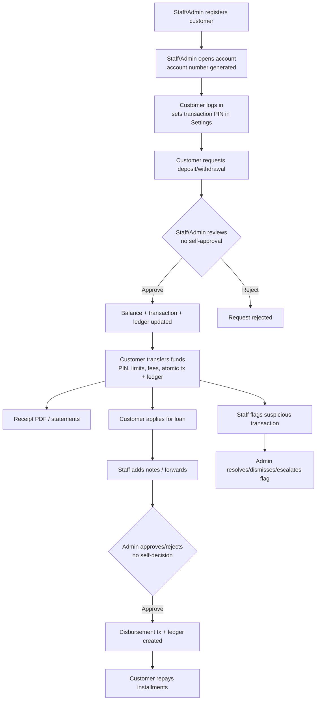
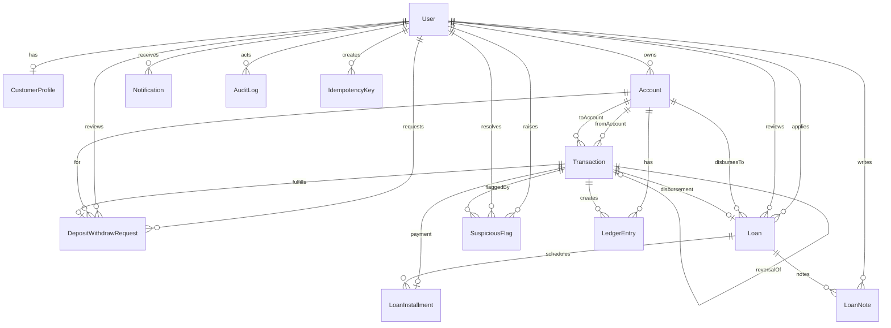

# NexaBank

NexaBank is a role-based digital banking simulation web application built with Next.js (App Router), TypeScript, Prisma, Neon/Postgres, NextAuth v5, Redux Toolkit/RTK Query, Tailwind CSS, and shadcn/ui.

> **Simulation only.** No real money, real banking rails, or real payment processing. Do not enter real personal or banking data.

## 1. Project Overview

NexaBank simulates core banking workflows for three roles: **Admin**, **Staff**, and **Customer**. It focuses on secure role-based access, auditable money operations, and a modern dashboard UI.

Key capabilities include customer onboarding, account management, deposits/withdrawals via approval workflow, customer-to-customer transfers with PIN verification, loan application/review/disbursement/repayment, suspicious transaction flagging, notifications, audit logs, and admin analytics/settings.

## 2. Application Features

### Admin
- Dashboard analytics (KPIs, charts, work queues).
- Customer management and customer detail view (profile, KYC, accounts, recent transactions).
- Account creation and account controls (freeze/unfreeze, limits).
- Customer status management (activate/deactivate/block).
- Deposit/withdrawal request review (approve/reject, self-approval blocked).
- Loan review: forward/note, approve/reject, disbursement tracking, installment visibility.
- Transaction monitoring, flagging, and admin-only reversal.
- Suspicious flag review/resolution (admin-only resolution).
- Audit logs and bank-wide settings (limits/fees/loan rates).

### Staff
- Staff dashboard and operational queues.
- Register customers, verify/update KYC, view customer details.
- Create accounts and view customer/account/transaction context.
- Review deposit/withdrawal requests (approve/reject, self-approval blocked).
- Flag suspicious transactions; view suspicious queue (resolution by admin).
- Assist loans with notes/forwarding (no approve/reject).

### Customer
- Dashboard with balance/activity summary, account switcher (multi-account), active loans, and charts.
- Account list/detail and statement/receipt downloads (where available).
- Transfer funds with transaction PIN and idempotency protection.
- Deposit/withdrawal requests and request tracking.
- Loan application, loan details, installment repayment.
- Notifications and profile/settings (password/PIN/theme/2FA placeholder state).

### Bonus / Implemented Extras
- Atomic transfer flow with serializable retry, row locks, ledger entries, idempotency keys.
- Transaction PIN lockout and login lockout.
- Receipts (PDF) and statements (CSV/PDF).
- Dark mode support.
- Admin-configurable banking limits/fees.

## 3. User Roles & Permissions

| Action | ADMIN | STAFF | CUSTOMER |
|---|:---:|:---:|:---:|
| Login / session-based access | Yes | Yes | Yes |
| View own profile/notifications/settings | Yes | Yes | Yes |
| Register customers / create accounts | Yes | Yes | No |
| View customers list/detail | Yes | Yes | No (own only where applicable) |
| Update KYC | Yes | Yes | No |
| View accounts / transactions / loans (operational) | Yes | Yes (read/support scope) | Own only |
| Flag suspicious transactions | Yes | Yes | No |
| **Resolve/dismiss/escalate suspicious flags** | **Yes** | **No** | **No** |
| Loan note / forward to review | Yes | Yes | No |
| **Loan approve / reject** | **Yes** (not own loan) | **No** | **No** |
| **Account freeze / unfreeze / set limits** | **Yes** | **No** | **No** |
| **Customer activate/deactivate/block** | **Yes** | **No** | **No** |
| **Transaction reverse** | **Yes** | **No** | **No** |
| **Bank-wide settings / audit logs** | **Yes** | **No** | **No** |
| Deposit/withdraw request approve/reject | Yes | Yes (not self) | No |
| Create deposit/withdraw request | No | No | Yes |
| Transfer funds / repay loan / apply loan | No | No | Yes (own accounts) |

**Enforcement:** route guards (`src/proxy.ts`, `src/lib/guards.ts`) + service-layer checks (e.g. `loanService`, `accountService`, `customerService`, `transactionService`, `suspiciousFlagService`, `requestService`) + UI hiding for restricted actions.

## Typical Workflow (How the system is used)

> **Demo note:** `customer1@nexabank.com` has seeded accounts and demo data. A newly registered customer starts with **no account**; staff/admin must open an account before the customer can request deposits, transfer, or apply for loans tied to an account.

1. **Staff registers a customer.** Customers cannot self-register. Admin/Staff create the customer record from the customer management flow; the customer receives credentials for login.
2. **Staff or Admin opens an account.** An account is created for the customer and the account number is generated at creation time. A newly onboarded customer has no accounts until this step is completed.
3. **Customer logs in and sets a transaction PIN.** From Customer Settings, the customer sets/updates their transaction PIN. The PIN is required for PIN-gated money actions such as transfers.
4. **Customer requests a deposit (or withdrawal).** The customer submits a deposit/withdrawal request. Staff/Admin reviews and approves or rejects it; self-approval is blocked. On approval, the balance/transaction/ledger records are updated atomically.
5. **Customer transfers money.** The customer transfers from an owned active account using their transaction PIN. The system enforces ownership, limits, fees, sufficient funds/min balance, idempotency, serializable DB transaction, row locks, and ledger entries. Receipt PDF and account statements are available for transaction history.
6. **Customer applies for a loan.** Staff can add notes and forward the loan for review; **only Admin can approve or reject** (and not their own loan). Admin approval/disbursement creates the disbursement transaction/ledger entries. The customer repays installments from their account.
7. **Staff flags suspicious transactions; Admin resolves them.** Staff/Admin can flag suspicious activity. Only Admin can resolve/dismiss/escalate suspicious flags.



## 4. Authentication Strategy

- **Auth library:** NextAuth v5 (`next-auth@beta`) with **Credentials** provider (`src/lib/auth.ts`).
- **Session strategy:** JWT session. JWT/session includes `id`, `role`, `sessionVersion`.
- **Login protections:** password verified with bcrypt; failed login counter; lockout after 5 failed attempts for 15 minutes; inactive/blocked users cannot sign in.
- **Session invalidation field:** `User.sessionVersion` exists and is included in token; guards check DB user status/role on protected server calls. (Session version comparison is not fully enforced in every guard path.)
- **Route protection:** `src/proxy.ts` protects `/admin`, `/staff`, `/customer`, and `/api` (except `/api/auth`), redirects unauthenticated page requests to `/login?callbackUrl=...`, returns 401 JSON for protected API requests, and enforces role-area access.
- **Server-side guards:** `requireAuth` / `requireRole` in `src/lib/guards.ts`; layouts catch UNAUTHORIZED/FORBIDDEN for safe redirects.
- **Transaction PIN:** customer transfer flow verifies hashed PIN (`pinHash`), tracks failed PIN attempts, locks PIN for 15 minutes after 3 failures.
- **2FA:** `twoFactorEnabled` field exists; full TOTP 2FA flow is not implemented yet (demo accounts should be treated as 2FA off).

## 5. Redux Toolkit Architecture

### Store setup
- Store factory: `src/store/index.ts` (`makeStore`).
- Typed hooks/types: `RootState`, `AppDispatch`, `AppStore`.
- RTK Query API reducer mounted as `[baseApi.reducerPath]`.

### Slices
Located in `src/store/slices/`:
- `authSlice`
- `uiSlice`
- `accountSlice`
- `transactionSlice`
- `loanSlice`
- `notificationSlice`

### Middleware
- `baseApi.middleware` (RTK Query)
- `loadingMiddleware` (`src/store/middleware/loadingMiddleware.ts`) for request loading state handling.

### Folder tree (state/API)
```text
src/store/
  index.ts
  api/
    baseApi.ts
    accountsApi.ts
    analyticsApi.ts
    auditLogsApi.ts
    customersApi.ts
    loansApi.ts
    notificationsApi.ts
    profileApi.ts
    requestsApi.ts
    settingsApi.ts
    suspiciousFlagsApi.ts
    transactionsApi.ts
  middleware/
    loadingMiddleware.ts
  slices/
    accountSlice.ts
    authSlice.ts
    loanSlice.ts
    notificationSlice.ts
    transactionSlice.ts
    uiSlice.ts
```

## 6. RTK Query Implementation

- **Base API:** `src/store/api/baseApi.ts` using `createApi` + `fetchBaseQuery`.
- **Base URL:** `/api`, `credentials: "include"`.
- **Custom base query:** wraps errors into `{ status, code, message, fields }`; shows toast errors (Sonner); on 401 in browser, shows session-expired toast and signs out to `/login`.
- **Tag types:** `Account`, `Transaction`, `Request`, `Loan`, `Notification`, `Customer`, `Analytics`, `Settings`, `Profile`, `SuspiciousFlag`, `AuditLog`.
- **Invalidation pattern:** mutations invalidate relevant tags/lists (e.g., transfer/request/loan actions invalidate account/transaction/request/loan/notification tags as applicable in endpoint files).
- **401 handling:** centralized in base query; protected pages/layouts also redirect on UNAUTHORIZED where needed.

## 7. Transaction Processing Logic

### Transfer flow (step-by-step)
1. **Auth & role:** customer-only endpoint/service (`POST /api/transfers`, `transferService.transfer`).
2. **Input validation:** Zod schema validates amount, source account, recipient account number, PIN, idempotency key.
3. **Idempotency (fast path):** check existing `IdempotencyKey` for user+key; return stored response if present.
4. **PIN verification:** bcrypt compare against `pinHash`; failed attempts tracked; lock after 3 failures (15 min).
5. **Serializable transaction:** run in Prisma transaction with serializable retry helper (`withSerializableRetry`).
6. **Idempotency inside tx:** re-check/create key to handle races; duplicate in-progress returns conflict.
7. **Load & validate accounts:** source owned by customer, recipient exists, not same account, both ACTIVE, owners ACTIVE.
8. **Deterministic row locks:** `SELECT ... FOR UPDATE` on both account IDs in sorted order.
9. **Business rules:** per-tx limit, daily limit, sufficient funds, minimum balance, fee calculation (same-owner transfer fee waived).
10. **Atomic updates:** update balances, create `Transaction` (COMPLETED), create `LedgerEntry` rows (DEBIT/CREDIT), create SYSTEM fee credit ledger if fee > 0.
11. **Notifications:** create sender/recipient notifications.
12. **Idempotency store:** save response JSON in `IdempotencyKey`.

### Other money/request flows
- **Deposits/withdrawals:** customer creates request; admin/staff approve/reject; approval executes money movement in service layer with ledger/transaction records. Self-approval blocked.
- **Loan disbursement:** admin approves loan; disbursement creates transaction/ledger entries.
- **Loan repayment:** customer repays installment; creates repayment transaction/ledger and updates installment/loan state.
- **Reversal:** admin-only; creates reversal transaction and compensating ledger entries (service-layer enforced).
- **Audit logging:** important actions write `AuditLog` records.

## 8. Database Structure

### Main models
- **User / CustomerProfile:** identity, role/status, auth/PIN fields, KYC profile.
- **Account:** account number, owner, type/status, balance, limits/min balance.
- **Transaction / LedgerEntry:** immutable money records; ledger is source of account movement history.
- **IdempotencyKey:** prevents duplicate transfer processing.
- **DepositWithdrawRequest:** approval workflow for deposits/withdrawals.
- **Loan / LoanInstallment / LoanNote:** loan lifecycle, schedule, repayment, review notes.
- **SuspiciousFlag:** staff/admin/system flags for transactions.
- **Notification:** in-app user notifications.
- **AuditLog:** actor/action/entity/before-after trace.
- **Settings:** bank-wide configurable limits/fees/rates.

### Mermaid ER diagram (simplified)


## 9. Security Implementation

- **Route protection:** `src/proxy.ts` enforces auth and role-area access; API returns 401/403 JSON.
- **Server-side authz:** `requireAuth`/`requireRole` in API routes and layouts; service-layer role checks for sensitive actions.
- **Ownership checks:** account/transaction/loan/request access scoped by role and owner where applicable.
- **Sensitive action restrictions:** admin-only for loan approve/reject, freeze/unfreeze/limits, customer status, tx reverse, suspicious-flag resolution, settings/audit.
- **Self-approval guard:** `assertNotSelf` prevents approving/rejecting own request and self loan decisions.
- **PIN security:** bcrypt-hashed PIN, failed-attempt tracking, temporary PIN lockout.
- **Login lockout:** failed login count + temporary lock.
- **Atomic money ops:** serializable transactions, deterministic row locks, ledger entries, idempotency keys.
- **Audit logs:** critical operations recorded.
- **Input validation:** Zod schemas in API/service boundaries.
- **Secrets:** no secrets committed; `.env*` ignored; `.env.example` committed.
- **Known hardening gaps:** no explicit security headers in `next.config.ts`; full sessionVersion enforcement/2FA not complete.

## 10. Environment Variables

| Name | Required | Description | Example |
|---|---|---|---|
| `DATABASE_URL` | Yes | Primary Postgres/Neon connection string (pooled/runtime recommended). | `postgresql://...` |
| `DIRECT_URL` | Yes | Direct Postgres connection for Prisma migrations/introspection. | `postgresql://...` |
| `TEST_DATABASE_URL` | Yes (tests) | Separate Postgres DB for integration tests. | `postgresql://.../nexa_test?schema=public` |
| `AUTH_SECRET` | Yes | NextAuth secret for signing/encryption. | `long-random-secret` |
| `NEXTAUTH_URL` | Yes | App base URL used by auth in deployed/local env. | `http://localhost:3000` |
| `BANK_TIMEZONE` | Optional | Banking timezone for date logic where used. | `Asia/Dhaka` |

See `.env.example`. Never commit real `.env` values.

## 11. Local Setup Instructions

### Prerequisites
- Node.js 20+ (recommended 22)
- npm
- Postgres database (Neon or local Postgres)
- Separate test database for integration tests

### Install
```bash
npm install
```

### Configure environment
1. Copy `.env.example` to `.env`.
2. Fill required values (do not commit `.env`).

### Prisma
```bash
npx prisma generate
npx prisma migrate dev
```

### Seed demo data
```bash
npm run db:seed
npm run seed:demo
```

> For Neon/remote, use `DIRECT_URL` as `DATABASE_URL` per command only if needed; do not print credentials.

### Run app
```bash
npm run dev
```
Open [http://localhost:3000](http://localhost:3000).

### Tests/checks
```bash
npm run lint
npm run typecheck
npm run test
npm run build
```

## 12. Deployment Instructions (Vercel + Neon)

1. **Create Neon DB** (or branch). Get pooled `DATABASE_URL` and direct `DIRECT_URL`.
2. **Import repo into Vercel**.
3. **Set env vars** in Vercel: `DATABASE_URL`, `DIRECT_URL`, `AUTH_SECRET`, `NEXTAUTH_URL` (production URL), `BANK_TIMEZONE`. Do **not** set `TEST_DATABASE_URL` in Vercel.
   - **Neon/pooling note:** runtime uses `DATABASE_URL`; Prisma migrations use `DIRECT_URL`. This app uses Serializable transactions and `FOR UPDATE` row locks for money flows; verify your Neon pooler mode/connection strategy in production (prefer direct/runtime-compatible settings if you see transaction isolation issues).
4. **Deploy**. The app build runs `prisma generate && next build` (see `package.json`). Vercel install/build should work without extra hooks.
5. **Run migrations** against production DB:
   ```bash
   npx prisma migrate deploy
   ```
6. **Seed demo data** (optional, after Neon backup branch):
   ```bash
   npm run db:seed
   npm run seed:demo
   ```
7. **Verify** login for all demo roles and key flows on live URL.

## 13. Demo Credentials

From `src/lib/demo-credentials.ts` and seed scripts:

| Role | Email | Password | Transaction PIN |
|---|---|---|---|
| Admin | `admin@nexabank.com` | `Password@123` | — |
| Staff | `staff1@nexabank.com` | `Password@123` | — |
| Customer | `customer1@nexabank.com` | `Password@123` | `123456` |

> Demo/simulation only. Not real credentials. No real money.

## 14. Additional Libraries Used

- **@prisma/client / prisma** — ORM, migrations, typed DB access.
- **next-auth** — credentials auth, JWT session.
- **bcryptjs** — password/PIN hashing.
- **zod** — runtime input validation.
- **decimal.js** — precise money arithmetic.
- **@reduxjs/toolkit + react-redux** — state management and RTK Query.
- **@react-pdf/renderer** — PDF receipt/statement generation.
- **recharts** — dashboard charts.
- **sonner** — toast notifications.
- **lucide-react** — icons.
- **@paper-design/shaders-react** — landing page shader backgrounds.
- **vitest + testing-library + playwright** — unit/integration/e2e testing.

## 15. Screenshots

No committed screenshot assets are included in this repository at the moment. You can generate local screenshots with Playwright (e.g. `npm run screenshots` for landing screenshots, or project e2e specs) and add them to a `docs/screenshots/` or `public/screenshots/` folder if desired (ensure no secrets/real data are visible).

## 16. Known Limitations / Simulated Parts

- **No real payments/banking rails.** All money movement is simulated in the app database.
- **Deposits/withdrawals are request + approval workflows**, not real bank transfers.
- **2FA is not fully implemented** (field exists; TOTP enrollment/enforcement not complete).
- **Session version invalidation is partial** (token has `sessionVersion`; guards do not fully compare it on every request).
- **Baseline security headers** are configured in `next.config.ts`; review CSP/frame/embed needs for your final deployment environment.
- **Build warning noise:** production build may emit pre-existing `HANGING_PROMISE_REJECTION`/`headers()` prerender warnings for some API routes during static generation; evaluate before deployment.
- **Visual verification** should be done manually in browser for responsive/dark-mode final signoff before submission.

## CI

GitHub Actions (`.github/workflows/ci.yml`) runs on push/PR to `main`: install, Prisma generate/migrate, lint, typecheck, migrate test DB, test, build. Configure repository secrets: `DATABASE_URL`, `DIRECT_URL`, `TEST_DATABASE_URL`, `AUTH_SECRET`, `NEXTAUTH_URL`, optional `BANK_TIMEZONE`. Never commit secret values.
