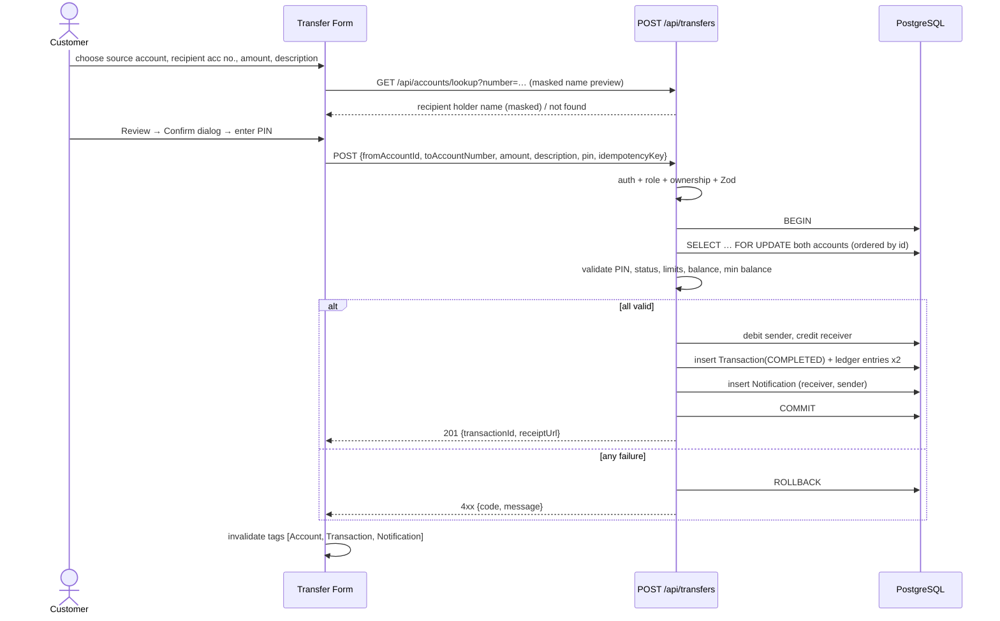
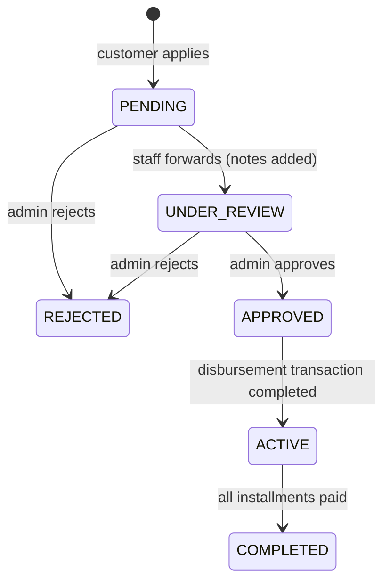

# 02 — Application Flow

Defines routes, navigation, and step-by-step flows for every role. Mermaid diagrams render on GitHub.

---

## 1. Route Map (Next.js App Router)

```
app/
├─ (public)/
│  ├─ page.tsx                      /                 Landing (optional) → redirects by role
│  └─ login/page.tsx                /login
├─ (customer)/customer/
│  ├─ dashboard                     /customer/dashboard
│  ├─ accounts                      /customer/accounts
│  ├─ accounts/[id]                 /customer/accounts/:id        details + statement download
│  ├─ transfer                      /customer/transfer
│  ├─ requests                      /customer/requests            deposit/withdraw requests list
│  ├─ requests/new                  /customer/requests/new
│  ├─ transactions                  /customer/transactions
│  ├─ transactions/[id]             /customer/transactions/:id    detail + receipt
│  ├─ loans                         /customer/loans
│  ├─ loans/apply                   /customer/loans/apply
│  ├─ loans/[id]                    /customer/loans/:id           schedule + repayments
│  ├─ notifications                 /customer/notifications
│  └─ settings                      /customer/settings            PIN, profile, theme
├─ (staff)/staff/
│  ├─ dashboard                     /staff/dashboard
│  ├─ customers                     /staff/customers
│  ├─ customers/new                 /staff/customers/new
│  ├─ customers/[id]                /staff/customers/:id
│  ├─ accounts/new                  /staff/accounts/new
│  ├─ requests                      /staff/requests               pending deposit/withdrawal
│  ├─ transactions                  /staff/transactions
│  ├─ transactions/[id]             /staff/transactions/:id
│  ├─ loans                         /staff/loans
│  └─ loans/[id]                    /staff/loans/:id              notes + forward
├─ (admin)/admin/
│  ├─ dashboard                     /admin/dashboard
│  ├─ customers, customers/[id]
│  ├─ accounts, accounts/new, accounts/[id]
│  ├─ requests
│  ├─ transactions, transactions/[id]
│  ├─ suspicious                    /admin/suspicious
│  ├─ loans, loans/[id]
│  ├─ staff                         /admin/staff
│  ├─ settings                      /admin/settings               limits, fees
│  └─ audit-logs
└─ api/                             see 04_TRD.md
```

**Middleware redirect rules**
| Request | Result |
|---|---|
| No session → any protected route | `/login?callbackUrl=…` |
| Logged in at `/login` | redirect to role home |
| CUSTOMER → `/admin/*` or `/staff/*` | redirect to `/customer/dashboard` (+ toast "Not authorized") |
| STAFF → `/admin/*` | redirect to `/staff/dashboard` |
| Customer with status BLOCKED / INACTIVE | session rejected → `/login?error=AccountDisabled` |

> The middleware is UX only. Every API route re-checks session + role + ownership.

---

## 2. Authentication Flow

```mermaid
flowchart TD
  A[Open /login] --> B[Enter email + password]
  B --> C{Zod validation}
  C -- invalid --> B
  C -- ok --> D[NextAuth Credentials authorize]
  D --> E{User exists & password ok?}
  E -- no --> F[Increment failedLogins, show error] --> B
  E -- yes --> G{User status ACTIVE?}
  G -- no --> H[Show 'Account disabled / blocked']
  G -- yes --> I{2FA enabled? bonus}
  I -- yes --> J[Enter OTP] --> K
  I -- no --> K[Issue JWT: id, role]
  K --> L{role}
  L -- CUSTOMER --> M[/customer/dashboard]
  L -- STAFF --> N[/staff/dashboard]
  L -- ADMIN --> O[/admin/dashboard]
```

Logout clears session and resets RTK Query cache (`api.util.resetApiState()`), plus Redux auth slice.

---

## 3. Customer Flows

### 3.1 Dashboard load
1. Layout loads session → hydrates `auth` slice.
2. `getMyAccounts` query → `accounts` slice selects first account (or persisted `activeAccountId`).
3. Dashboard queries (parallel): `getCustomerSummary`, `getRecentTransactions`, `getActiveLoans`, charts endpoints.
4. Account switcher change → `setActiveAccount` → dependent queries refetch with `accountId` arg.

### 3.2 Fund Transfer


Error codes surfaced to the user: `INSUFFICIENT_FUNDS`, `INVALID_PIN`, `PIN_LOCKED`, `ACCOUNT_FROZEN`, `RECIPIENT_NOT_FOUND`, `LIMIT_EXCEEDED_SINGLE`, `LIMIT_EXCEEDED_DAILY`, `BELOW_MIN_BALANCE`, `SAME_ACCOUNT`, `DUPLICATE_REQUEST`.

### 3.3 Deposit / Withdrawal Request
1. Customer opens **Requests → New**, selects type, account, amount, description.
2. `POST /api/requests` → status `PENDING`, no balance change.
3. Staff/Admin sees it in queue → Approve / Reject (+ reason).
4. **Approve**: DB transaction → re-validate (withdrawal: balance) → update balance → create `Transaction` (COMPLETED) → mark request `APPROVED` → notify customer.
5. **Reject**: status `REJECTED`, reason stored, notify customer.
6. Customer can cancel while `PENDING` (status `CANCELLED`).

### 3.4 Loan Application → Repayment

- On approval (single DB tx): create `LOAN_DISBURSEMENT` transaction (bank → customer account), set loan `ACTIVE`, generate `LoanInstallment` rows, notify customer.
- Customer pays installment from loan detail page (PIN required) → `LOAN_REPAYMENT` transaction; installment `PAID`; `remainingBalance` decreases; last payment → `COMPLETED`.

### 3.5 Statement & Receipt
- Account detail → choose date range → **Download CSV / PDF** (`GET /api/accounts/:id/statement?from&to&format`).
- Transaction detail → **Download Receipt (PDF)** (`GET /api/transactions/:id/receipt`). Ownership checked.

---

## 4. Staff Flows

### 4.1 Register customer + open account
1. `/staff/customers/new`: personal info (name, email, phone, NID, DOB, address) + initial password (or invite).
2. Server creates `User(role=CUSTOMER)` + `CustomerProfile(kycStatus=PENDING)`.
3. Staff opens **Verify** → marks `VERIFIED` (or `REJECTED` with note).
4. `/staff/accounts/new`: pick customer, account type, optional opening deposit request → account number generated, status `ACTIVE`. Customer sets PIN on first login.

### 4.2 Transaction review
1. `/staff/transactions` → filters (date range, type, status), search by transaction ID, pagination.
2. Row → detail → **Flag as suspicious** (reason required) → creates `SuspiciousFlag(OPEN)` → appears in admin queue.
3. Pending queue: deposit/withdrawal requests → approve/reject (not own).

### 4.3 Loan assistance
`/staff/loans` → open → review applicant (profile, accounts, history) → **Add internal note** → **Forward to admin** (`PENDING → UNDER_REVIEW`). No approve/reject buttons; API also rejects.

---

## 5. Admin Flows
- **Dashboard:** KPI cards + 5 charts from `/api/admin/analytics/*`.
- **Customer management:** search/filter → detail (profile, accounts, loans, tx history) → `Activate / Deactivate / Block` with reason + confirm dialog. Blocking invalidates sessions (user `sessionVersion++`).
- **Account management:** create / edit / freeze-unfreeze / set limits (`dailyLimit`, `perTxLimit`, `minBalance`).
- **Loans:** queue → detail → Approve (choose disbursement account) / Reject (reason) → repayments tab.
- **Suspicious queue:** review flags → `DISMISS` or `ESCALATE` (optionally freeze account / reverse transaction).
- **Settings:** global limits & fee percent; changes written to `audit_logs`.

---

## 6. Global UX Flows
| Flow | Behavior |
|---|---|
| Loading | Skeletons per card/table; global top progress bar when any RTKQ request pending |
| Errors | Field errors inline; API errors via toast; page-level `error.tsx` boundaries; 403 → "Not authorized" page |
| Empty states | Illustrated empty state with CTA (e.g., "Make your first transfer") |
| Confirmation | Dialog for transfer, approve/reject, block, freeze, loan decisions |
| Notifications | Bell icon with unread badge; poll every 30s (`pollingInterval`) |
| Theme | Light/Dark/System toggle, persisted in localStorage + user setting |
