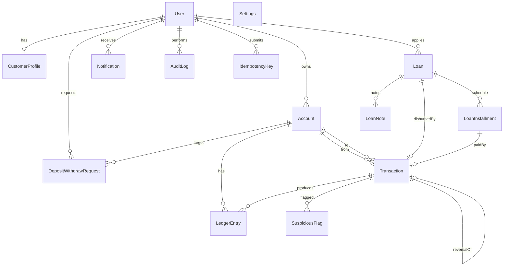

# 05 — Database Schema

**DB:** PostgreSQL · **ORM:** Prisma · **Money:** `Decimal(18,2)` · **IDs:** `cuid()` (human references are separate unique columns)

---

## 1. ER Diagram



---

## 2. Prisma Schema

```prisma
generator client { provider = "prisma-client-js" }
datasource db {
  provider  = "postgresql"
  url       = env("DATABASE_URL")
  directUrl = env("DIRECT_URL")
}

// ───────── Enums ─────────
enum Role            { ADMIN STAFF CUSTOMER }
enum UserStatus      { ACTIVE INACTIVE BLOCKED }
enum KycStatus       { PENDING VERIFIED REJECTED }
enum AccountType     { SAVINGS CURRENT BUSINESS SYSTEM }
enum AccountStatus   { ACTIVE FROZEN CLOSED }
enum TxType          { DEPOSIT WITHDRAWAL TRANSFER LOAN_DISBURSEMENT LOAN_REPAYMENT }
enum TxStatus        { PENDING COMPLETED FAILED REVERSED }
enum RequestType     { DEPOSIT WITHDRAWAL }
enum RequestStatus   { PENDING APPROVED REJECTED CANCELLED }
enum LoanType        { PERSONAL HOME AUTO EDUCATION BUSINESS }
enum EmploymentStatus{ EMPLOYED SELF_EMPLOYED BUSINESS_OWNER STUDENT UNEMPLOYED RETIRED }
enum LoanStatus      { PENDING UNDER_REVIEW APPROVED REJECTED ACTIVE COMPLETED }
enum InstallmentStatus { UPCOMING PAID OVERDUE }
enum EntryDirection  { DEBIT CREDIT }
enum FlagSource      { STAFF ADMIN SYSTEM }
enum FlagStatus      { OPEN DISMISSED ESCALATED }
enum NotificationType{ MONEY_RECEIVED TRANSFER_COMPLETED DEPOSIT_APPROVED DEPOSIT_REJECTED
                       WITHDRAWAL_APPROVED WITHDRAWAL_REJECTED LOAN_APPROVED LOAN_REJECTED
                       LOAN_UNDER_REVIEW ACCOUNT_FROZEN ACCOUNT_STATUS SYSTEM }

// ───────── Users ─────────
model User {
  id             String     @id @default(cuid())
  email          String     @unique
  passwordHash   String
  name           String
  phone          String?
  role           Role
  status         UserStatus @default(ACTIVE)
  sessionVersion Int        @default(0)          // bump to invalidate JWTs
  failedLogins   Int        @default(0)
  lockedUntil    DateTime?
  // Transaction PIN (customers)
  pinHash        String?
  pinFailedCount Int        @default(0)
  pinLockedUntil DateTime?
  twoFactorEnabled Boolean  @default(false)       // bonus
  theme          String     @default("system")
  createdById    String?
  createdAt      DateTime   @default(now())
  updatedAt      DateTime   @updatedAt

  profile        CustomerProfile?
  accounts       Account[]
  requests       DepositWithdrawRequest[] @relation("RequestRequester")
  reviewedReqs   DepositWithdrawRequest[] @relation("RequestReviewer")
  loans          Loan[]     @relation("LoanApplicant")
  reviewedLoans  Loan[]     @relation("LoanReviewer")
  loanNotes      LoanNote[]
  notifications  Notification[]
  auditLogs      AuditLog[]
  idempotency    IdempotencyKey[]
  flagsRaised    SuspiciousFlag[] @relation("FlagRaisedBy")
  flagsResolved  SuspiciousFlag[] @relation("FlagResolvedBy")

  @@index([role, status])
}

model CustomerProfile {
  id            String    @id @default(cuid())
  userId        String    @unique
  user          User      @relation(fields: [userId], references: [id], onDelete: Cascade)
  customerNo    String    @unique               // CUS-000123
  nid           String    @unique
  dateOfBirth   DateTime
  fatherName    String?
  motherName    String?
  occupation    String?
  presentAddress   String
  permanentAddress String?
  kycStatus     KycStatus @default(PENDING)
  kycNote       String?
  verifiedById  String?
  verifiedAt    DateTime?
  createdAt     DateTime  @default(now())
  updatedAt     DateTime  @updatedAt
}

// ───────── Accounts ─────────
model Account {
  id            String        @id @default(cuid())
  accountNumber String        @unique           // 12 digits
  ownerId       String?                          // null only for SYSTEM account
  owner         User?         @relation(fields: [ownerId], references: [id])
  type          AccountType
  status        AccountStatus @default(ACTIVE)
  currency      String        @default("BDT")
  balance       Decimal       @default(0) @db.Decimal(18, 2)
  // Per-account limits (null = fall back to global Settings)
  dailyTransferLimit Decimal? @db.Decimal(18, 2)
  perTxLimit         Decimal? @db.Decimal(18, 2)
  minBalance         Decimal? @db.Decimal(18, 2)
  nickname      String?
  freezeReason  String?
  openedAt      DateTime      @default(now())
  createdById   String?
  updatedAt     DateTime      @updatedAt

  sentTx        Transaction[] @relation("TxFrom")
  receivedTx    Transaction[] @relation("TxTo")
  ledger        LedgerEntry[]
  requests      DepositWithdrawRequest[]
  loansDisbursedTo Loan[]

  @@index([ownerId])
  @@index([status])
  // raw SQL migration adds: CHECK (balance >= 0 OR type = 'SYSTEM')
}

// ───────── Transactions ─────────
model Transaction {
  id            String     @id @default(cuid())
  reference     String     @unique               // TXN-20261121-8K2M4QX7
  type          TxType
  status        TxStatus   @default(PENDING)
  fromAccountId String?
  toAccountId   String?
  fromAccount   Account?   @relation("TxFrom", fields: [fromAccountId], references: [id])
  toAccount     Account?   @relation("TxTo",   fields: [toAccountId],   references: [id])
  amount        Decimal    @db.Decimal(18, 2)     // CHECK amount > 0
  fee           Decimal    @default(0) @db.Decimal(18, 2)
  currency      String     @default("BDT")
  description   String?
  failureReason String?
  reversalOfId  String?    @unique
  reversalOf    Transaction? @relation("Reversal", fields: [reversalOfId], references: [id])
  reversedBy    Transaction? @relation("Reversal")
  initiatedById String?                           // user who triggered it
  requestId     String?    @unique                // linked deposit/withdraw request
  request       DepositWithdrawRequest? @relation(fields: [requestId], references: [id])
  createdAt     DateTime   @default(now())
  completedAt   DateTime?

  ledger        LedgerEntry[]
  flags         SuspiciousFlag[]
  loanDisbursed Loan?
  installment   LoanInstallment?

  @@index([fromAccountId, createdAt])
  @@index([toAccountId, createdAt])
  @@index([type, status, createdAt])
  @@index([createdAt])
}

// Double-entry ledger: preserves immutable history & balance-after snapshots
model LedgerEntry {
  id            String          @id @default(cuid())
  transactionId String
  transaction   Transaction     @relation(fields: [transactionId], references: [id])
  accountId     String
  account       Account         @relation(fields: [accountId], references: [id])
  direction     EntryDirection
  amount        Decimal         @db.Decimal(18, 2)
  balanceAfter  Decimal         @db.Decimal(18, 2)
  createdAt     DateTime        @default(now())

  @@index([accountId, createdAt])
  @@index([transactionId])
}

model IdempotencyKey {
  id         String   @id @default(cuid())
  userId     String
  user       User     @relation(fields: [userId], references: [id])
  key        String
  endpoint   String
  responseJson Json?
  createdAt  DateTime @default(now())

  @@unique([userId, key])
}

// ───────── Deposit / Withdrawal requests ─────────
model DepositWithdrawRequest {
  id            String        @id @default(cuid())
  type          RequestType
  status        RequestStatus @default(PENDING)
  accountId     String
  account       Account       @relation(fields: [accountId], references: [id])
  requesterId   String
  requester     User          @relation("RequestRequester", fields: [requesterId], references: [id])
  amount        Decimal       @db.Decimal(18, 2)
  description   String?
  requestedAt   DateTime      @default(now())
  reviewedById  String?
  reviewer      User?         @relation("RequestReviewer", fields: [reviewedById], references: [id])
  reviewedAt    DateTime?
  rejectionReason String?
  transaction   Transaction?

  @@index([status, requestedAt])
  @@index([requesterId])
  @@index([accountId])
  // raw SQL: CHECK ("reviewedById" IS NULL OR "reviewedById" <> "requesterId")
}

// ───────── Loans ─────────
model Loan {
  id              String           @id @default(cuid())
  loanNo          String           @unique            // LN-2026-000045
  applicantId     String
  applicant       User             @relation("LoanApplicant", fields: [applicantId], references: [id])
  type            LoanType
  requestedAmount Decimal          @db.Decimal(18, 2)
  approvedAmount  Decimal?         @db.Decimal(18, 2)
  durationMonths  Int
  interestRate    Decimal          @db.Decimal(5, 2)  // annual %
  emiAmount       Decimal?         @db.Decimal(18, 2)
  monthlyIncome   Decimal          @db.Decimal(18, 2)
  employmentStatus EmploymentStatus
  description     String?
  status          LoanStatus       @default(PENDING)
  disbursementAccountId String?
  disbursementAccount   Account?   @relation(fields: [disbursementAccountId], references: [id])
  disbursementTxId String?         @unique
  disbursementTx   Transaction?    @relation(fields: [disbursementTxId], references: [id])
  totalPayable    Decimal?         @db.Decimal(18, 2)
  remainingBalance Decimal?        @db.Decimal(18, 2)
  forwardedById   String?
  reviewedById    String?
  reviewer        User?            @relation("LoanReviewer", fields: [reviewedById], references: [id])
  reviewedAt      DateTime?
  rejectionReason String?
  appliedAt       DateTime         @default(now())
  disbursedAt     DateTime?
  completedAt     DateTime?

  installments    LoanInstallment[]
  notes           LoanNote[]

  @@index([applicantId, status])
  @@index([status, appliedAt])
  // raw SQL: CHECK ("reviewedById" IS NULL OR "reviewedById" <> "applicantId")
}

model LoanInstallment {
  id          String            @id @default(cuid())
  loanId      String
  loan        Loan              @relation(fields: [loanId], references: [id], onDelete: Cascade)
  number      Int
  dueDate     DateTime
  principal   Decimal           @db.Decimal(18, 2)
  interest    Decimal           @db.Decimal(18, 2)
  amount      Decimal           @db.Decimal(18, 2)      // principal + interest
  status      InstallmentStatus @default(UPCOMING)
  paidAt      DateTime?
  paymentTxId String?           @unique
  paymentTx   Transaction?      @relation(fields: [paymentTxId], references: [id])

  @@unique([loanId, number])
  @@index([dueDate, status])
}

model LoanNote {
  id        String   @id @default(cuid())
  loanId    String
  loan      Loan     @relation(fields: [loanId], references: [id], onDelete: Cascade)
  authorId  String
  author    User     @relation(fields: [authorId], references: [id])
  body      String
  internal  Boolean  @default(true)           // never exposed to customers
  createdAt DateTime @default(now())

  @@index([loanId, createdAt])
}

// ───────── Monitoring ─────────
model SuspiciousFlag {
  id            String     @id @default(cuid())
  transactionId String
  transaction   Transaction @relation(fields: [transactionId], references: [id])
  source        FlagSource
  ruleCode      String?                      // e.g. HIGH_AMOUNT, VELOCITY
  reason        String
  status        FlagStatus @default(OPEN)
  raisedById    String?
  raisedBy      User?      @relation("FlagRaisedBy", fields: [raisedById], references: [id])
  resolvedById  String?
  resolvedBy    User?      @relation("FlagResolvedBy", fields: [resolvedById], references: [id])
  resolutionNote String?
  createdAt     DateTime   @default(now())
  resolvedAt    DateTime?

  @@index([status, createdAt])
  @@index([transactionId])
}

model Notification {
  id        String           @id @default(cuid())
  userId    String
  user      User             @relation(fields: [userId], references: [id], onDelete: Cascade)
  type      NotificationType
  title     String
  message   String
  link      String?
  read      Boolean          @default(false)
  createdAt DateTime         @default(now())

  @@index([userId, read, createdAt])
}

model AuditLog {
  id         String   @id @default(cuid())
  actorId    String?
  actor      User?    @relation(fields: [actorId], references: [id])
  action     String                      // ACCOUNT_FROZEN, LOAN_APPROVED, SETTINGS_UPDATED…
  entityType String
  entityId   String?
  before     Json?
  after      Json?
  ip         String?
  createdAt  DateTime @default(now())

  @@index([actorId, createdAt])
  @@index([entityType, entityId])
}

// Singleton row (id = 1)
model Settings {
  id                  Int      @id @default(1)
  dailyTransferLimit  Decimal  @default(200000) @db.Decimal(18, 2)
  maxSingleTransaction Decimal @default(100000) @db.Decimal(18, 2)
  minAccountBalance   Decimal  @default(0)      @db.Decimal(18, 2)
  transferFeePercent  Decimal  @default(0.50)   @db.Decimal(5, 2)
  minTransferFee      Decimal  @default(5)      @db.Decimal(18, 2)
  loanIncomeMultiplier Int     @default(20)
  loanInterestRates   Json     // { PERSONAL: 12, HOME: 9, AUTO: 10, EDUCATION: 8, BUSINESS: 11 }
  updatedById         String?
  updatedAt           DateTime @updatedAt
}
```

---

## 3. Raw SQL Constraints (added in a custom migration)
```sql
ALTER TABLE "Account"     ADD CONSTRAINT balance_non_negative CHECK (balance >= 0 OR type = 'SYSTEM');
ALTER TABLE "Transaction" ADD CONSTRAINT amount_positive      CHECK (amount > 0);
ALTER TABLE "Transaction" ADD CONSTRAINT fee_non_negative     CHECK (fee >= 0);
ALTER TABLE "DepositWithdrawRequest"
  ADD CONSTRAINT no_self_review CHECK ("reviewedById" IS NULL OR "reviewedById" <> "requesterId");
ALTER TABLE "Loan"
  ADD CONSTRAINT no_self_approve CHECK ("reviewedById" IS NULL OR "reviewedById" <> "applicantId");
```
> `Transaction` and `LedgerEntry` rows are never deleted/updated except `status`, `completedAt`, `failureReason` (a trigger can block `DELETE` on both tables).

---

## 4. Table Reference & Business Notes

| Table | Purpose | Key rules |
|---|---|---|
| `User` | Auth identity for all roles | `sessionVersion` bump on block/deactivate; PIN hashed separately |
| `CustomerProfile` | KYC & personal info | Created by staff; `kycStatus` verified by staff/admin |
| `Account` | Bank account | Balance mutated **only** in services within DB tx; `SYSTEM` account is the bank counterparty |
| `Transaction` | Business-level transaction | `reference` unique; immutable amounts; status transitions only PENDING→COMPLETED/FAILED, COMPLETED→REVERSED |
| `LedgerEntry` | Double-entry lines | One DEBIT + one CREDIT per movement; `balanceAfter` powers statements & running-balance charts |
| `IdempotencyKey` | Duplicate prevention | `(userId,key)` unique |
| `DepositWithdrawRequest` | Request workflow | Approver ≠ requester (DB CHECK + service) |
| `Loan` / `LoanInstallment` | Loan lifecycle & schedule | Schedule generated on approval; remaining balance = sum of unpaid principal |
| `LoanNote` | Internal staff/admin notes | `internal=true`, filtered out from customer API |
| `SuspiciousFlag` | Flagged tx review | Raised by staff or rules; resolved by admin |
| `Notification` | In-app notifications | Created inside the same DB tx as the event |
| `AuditLog` | Privileged action trail | Written for admin/staff mutations |
| `Settings` | Bank-wide config | Singleton row, admin-only update |

## 5. Index Strategy
- Transactions list: `(fromAccountId, createdAt)`, `(toAccountId, createdAt)`, `(type,status,createdAt)`; search by `reference` (unique).
- Customer lookups: `User(role,status)`, `CustomerProfile(nid, customerNo)` unique, trigram index (`pg_trgm`) on `User.name`, `email` for search.
- Queue pages: `DepositWithdrawRequest(status, requestedAt)`, `Loan(status, appliedAt)`, `SuspiciousFlag(status, createdAt)`.
- Notifications: `(userId, read, createdAt)`.

## 6. Key Analytics Queries (real data → charts)

```sql
-- Monthly transaction volume (admin)
SELECT date_trunc('month', "createdAt") AS month, COUNT(*) AS count, SUM(amount) AS volume
FROM "Transaction" WHERE status = 'COMPLETED' AND "createdAt" >= now() - interval '12 months'
GROUP BY 1 ORDER BY 1;

-- Deposit vs Withdrawal
SELECT date_trunc('month', "createdAt") AS month,
       SUM(amount) FILTER (WHERE type = 'DEPOSIT')    AS deposits,
       SUM(amount) FILTER (WHERE type = 'WITHDRAWAL') AS withdrawals
FROM "Transaction" WHERE status = 'COMPLETED' GROUP BY 1 ORDER BY 1;

-- Account distribution
SELECT type, COUNT(*) FROM "Account" WHERE type <> 'SYSTEM' GROUP BY type;

-- Loan approval statistics
SELECT status, COUNT(*) FROM "Loan" GROUP BY status;

-- Customer monthly spending (outgoing, excl. own-account transfers)
SELECT date_trunc('month', l."createdAt") AS month, SUM(l.amount) AS spent
FROM "LedgerEntry" l JOIN "Account" a ON a.id = l."accountId"
WHERE a."ownerId" = $1 AND l.direction = 'DEBIT' GROUP BY 1 ORDER BY 1;
```

## 7. Seed Data Plan (`prisma/seed.ts`)
- Settings row; SYSTEM bank account (opening capital ৳100,000,000).
- Users: 1 admin, 2 staff, 8 customers (profiles, KYC mix of VERIFIED/PENDING).
- ~14 accounts across Savings/Current/Business (demo customer has 3).
- ~250 historical transactions over 12 months generated **through the real services** (so ledger & balances are consistent) — deposits, withdrawals, transfers.
- Requests: 5 pending, 6 approved, 3 rejected.
- Loans: 2 pending, 2 under review, 1 rejected, 2 active (with partly-paid schedules), 1 completed.
- 4 suspicious flags (2 open).
- Notifications for demo users.
- **Invariant test after seed:** `SUM(balance)` over all accounts (incl. SYSTEM as negative capital offset) equals ledger net.
